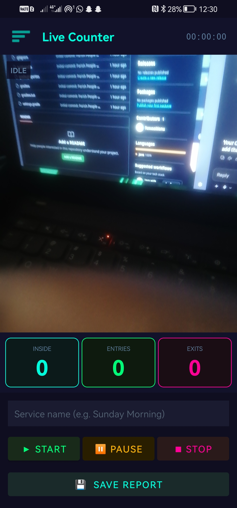
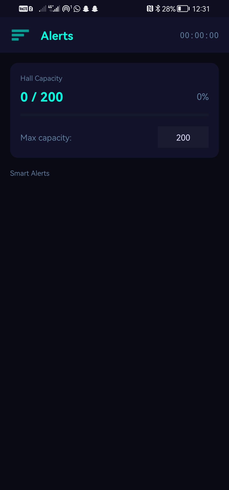
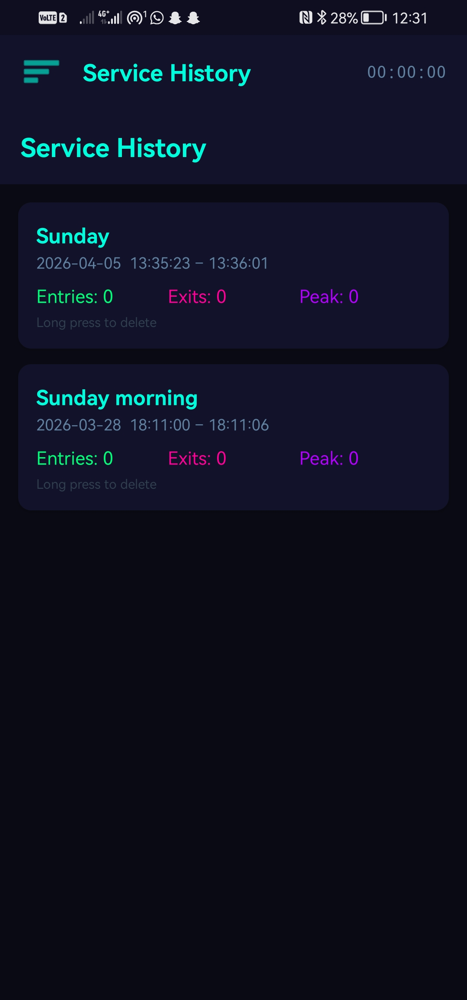
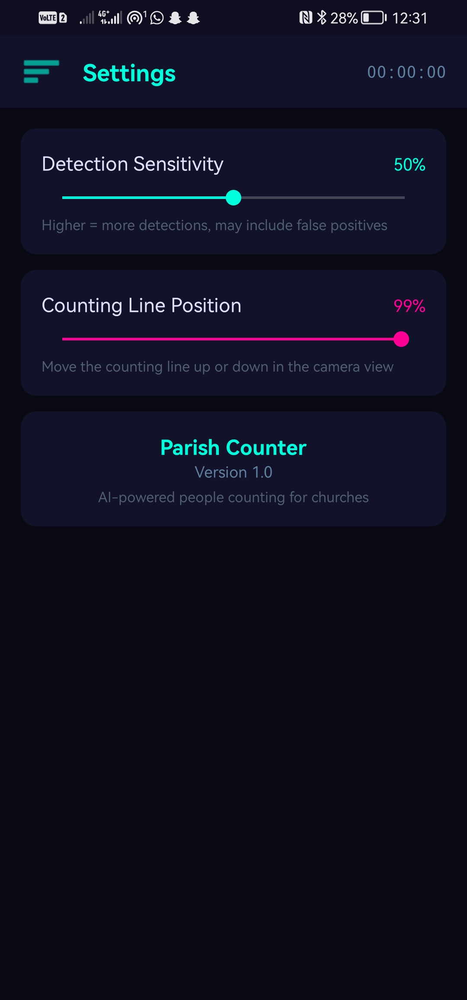

# Parish Counter

An Android app that counts people entering and leaving a hall using the phone camera. I built it so churches can track attendance and hall capacity without using a hand tally counter.

  
  
  
  

## What it does

- Counts people crossing a line in the camera view and shows **Inside**, **Entries** and **Exits** live
- Start, pause and stop a count, and name each service (e.g. "Sunday Morning")
- Saves a report for each service with entries, exits and peak attendance
- Service history: view past services, long-press to delete
- Hall capacity screen where you set the maximum number of people
- Settings to adjust detection sensitivity and move the counting line

## How it works

The camera feed goes through a TensorFlow Lite model (EfficientDet-Lite0) that detects people on the phone. A centroid tracker follows each person between frames so nobody is counted twice, and a counting engine checks which way they cross the line. Reports are saved in a local Room database.

## Built with

Java, Android Studio, CameraX, TensorFlow Lite, Room

## Run it

1. Clone the repo and open it in Android Studio
2. Let Gradle sync, then run it on a phone or an emulator with a camera
3. Allow camera access when asked

## Credits

Detection model: EfficientDet-Lite0 from TensorFlow (Apache 2.0).

## Author

Afia Fosuaa Manu, Computer Engineering student at the University of Mines and Technology, Ghana.
GitHub: [@fosuaaManu](https://github.com/fosuaaManu)
